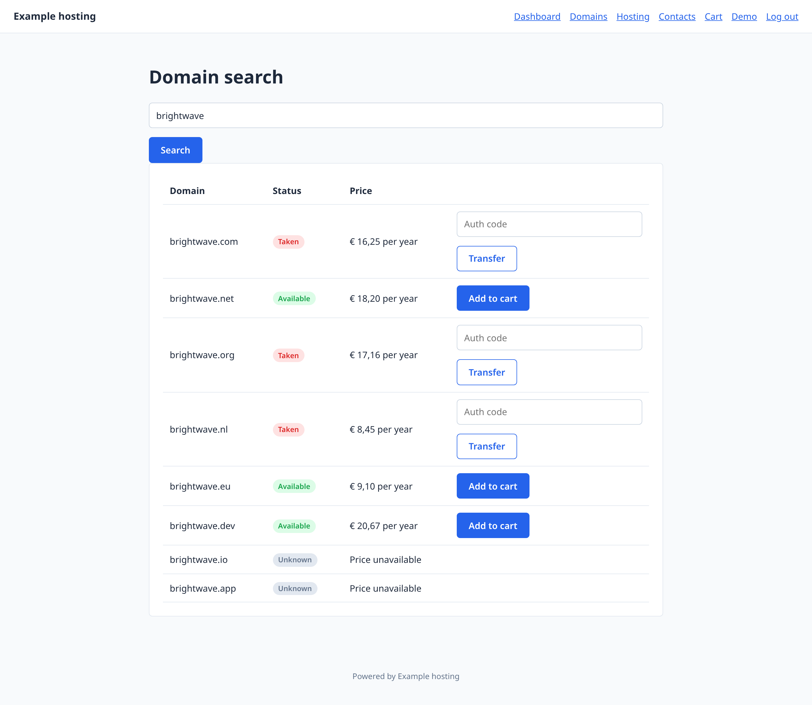

# Hosting panel

A white-label reseller hosting panel for LJPc services. Install it on your own
infrastructure, put your own brand on it, and sell domains and Plesk hosting to
your customers. The panel talks to the LJPc hosting platform through a single API
key, and you handle payments yourself through a small gateway seam you plug your
own PSP into. It is plain PHP with no framework, no runtime Composer packages, no
CDN assets, and no build step. Out of the box it runs in mock mode against
deterministic placeholder data, so you can click through the whole product before
you have an API key.



## Features

- Accounts: register, log in, log out, and password reset (mail goes through a
  `Mailer` seam).
- Domain search across the TLDs you configure, with per-TLD availability and your
  own retail prices, plus a cart for registrations and transfers.
- WHOIS contacts: create, read, and update.
- Domain management: status, expiry, nameservers, auto-renew and transfer-lock
  toggles, on-demand auth code reveal, and a per-domain DNS editor.
- Hosting: the packages you configure, a hosting list and detail view with a disk
  usage bar, and a single sign-on button into Plesk.
- Orders: cart, checkout (pick or create a WHOIS contact), a payment step through
  a `PaymentGateway` seam, and a provisioning page that polls until every line
  item completes or fails.
- Dashboard and account settings.
- One hand-written stylesheet driven by CSS custom properties, so rebranding is a
  few variables.

## Requirements

- PHP 8.2 or newer with `pdo_sqlite` (or `pdo_mysql`) and `curl`.
- Any of php-fpm behind nginx or Apache, Apache with mod_php, or FrankenPHP
  (classic or worker mode).
- Composer, for the autoloader only. There are zero runtime package dependencies
  and zero CDN assets.

## Quick start

1. Install the autoloader:

   ```bash
   composer install
   ```

2. Create your config from the example:

   ```bash
   cp config.example.php config.php
   ```

3. Point your webroot at `public/`. That directory holds the single front
   controller (`public/index.php`) and the static assets under `public/assets/`.

On the first request the SQLite database and its schema are created automatically
at `var/panel.sqlite`. The panel starts in mock mode (see below), so you can
register an account and click through the full flow right away.

### Local development with ddev

This repository is set up for ddev, with the docroot already pointed at
`public/`:

```bash
ddev start
```

The panel is then served at https://hostingpanel.ddev.site.

## Configuration

`config.php` returns a plain array. It is gitignored and is the source of truth
for what the panel sells and at what price.

### Choosing what you sell and your prices

Three keys decide your product range and your retail prices. This is where you do
most of your setup.

`packages` is the list of hosting products your storefront offers. Each entry:

| Field | Meaning |
|---|---|
| `id` | Your internal package id, referenced in orders and hosting rows. |
| `name` | Display name shown to customers. |
| `description` | Short description shown on the order page. |
| `monthly_price` | Your retail price per month, as a decimal in the configured currency. |
| `category_identifier` | The LJPc hosting product this package maps to, for example `hosting_5gb`, `hosting_20gb`, or `hosting_50gb`. This is what the API provisions. |

You pay LJPc your own account price for each product (including any valuepack
discount on your account) and keep the difference between that and your
`monthly_price` as margin. Add, remove, or rename packages freely. The panel only
ever offers the packages listed here.

`search_tlds` is the list of TLDs the domain search offers, for example
`['com', 'net', 'org', 'nl', 'eu', 'dev', 'io', 'app']`. The search only checks
the TLDs in this list, which also keeps it fast: each TLD costs two live API calls
per search (one availability, one price), and the full sellable catalog is around
1400 TLDs, far too many to fan out across. Keep this to the handful you actually
promote, and make sure every entry is a TLD your LJPc account can sell.

`domain_pricing` turns the price you pay LJPc for a domain into the retail price
your customer sees:

| Field | Meaning |
|---|---|
| `margin_percent` | The margin added on top of your cost for every TLD. `30` means your cost times 1.30. |
| `overrides` | A map of TLD to an absolute yearly retail price, for example `['nl' => 9.99]`. An override wins over the margin for that TLD. |

### Other settings

| Key | Meaning |
|---|---|
| `panel_name` | The brand name shown in the header, footer, and page titles. |
| `base_url` | The panel's public base URL. |
| `currency` | ISO currency code, for example `EUR`. Drives the currency symbol in the UI. |
| `db.driver` | `sqlite` or `mysql`. |
| `db.sqlite_path` | Absolute path to the SQLite file. Its directory is created if missing. Default `var/panel.sqlite`. |
| `db.mysql` | `host`, `port`, `database`, `username`, `password` for the MySQL or MariaDB driver. Only used when `driver` is `mysql`. |
| `api.base_url` | The LJPc API base URL, `https://ljpc-hosting.nl/api`. |
| `api.key` | Your LJPc API key. An empty string turns on mock mode. |
| `payment.gateway` | Which payment gateway to use. Ships as `manual`, a development placeholder. |
| `mail.mailer` | Which mailer to use. Ships as `log`, which writes to `var/mail.log`. |
| `mail.from` | The from address used by the mailer. |

## Mock mode vs live mode

The panel picks its API client based on `api.key`:

- An empty `api.key` (the default) selects `MockApiClient`. It serves
  deterministic placeholder data: a fixed TLD price table, availability derived
  from a hash of the domain name, stable fake disk usage, and orders that progress
  from processing to completed based on the time since creation. There is no
  randomness and no external network call. The mock "Log in to Plesk" URL points
  at a host that does not exist on purpose, so do not follow it.
- A non-empty `api.key` selects `LjpcApiClient`, the live HTTP client. It sends
  the key in the `X-API-Key` header on every request to `api.base_url`.

Mock state (registered domains, contacts, DNS records, provisioned sites) lives as
JSON files under `var/mock`. Delete that directory to reset the demo to a clean
slate:

```bash
rm -rf var/mock
```

## Going live

To go live you need an API key from LJPc. Request one, then set both API values in
`config.php`:

```php
'api' => [
    'base_url' => 'https://ljpc-hosting.nl/api',
    'key'      => 'your-reseller-api-key', // non-empty selects the live client
],
```

The endpoint contract and every response shape are documented in
`docs/reseller-api.md`, and the same API is documented online at
https://ljpc-hosting.nl/api-documentation.

### Required permissions

An API key is scoped by permissions, and a permission is only effective when it is
ticked on BOTH the key AND the key's owner user. Tick every box below on both
sides in the LJPc `/api-access` screen. The group headers match the screen.

- WHOIS contacts: view contacts, create contacts, update contacts.
- Domain names: check domain availability, check domain price. (Without these the
  domain search cannot price or check anything.)
- Hosting: view domains and sites, register domains, transfer domains, edit own
  domains, view auth codes, show own sites, log in to sites.
- DNS: manage DNS.
- Orders: view own orders, create orders.

The TLD catalog and the product catalog need no permission (a valid key is enough
for the TLD list, and the product list is public).

Do not request "log in to all sites" or "create orders with custom pricing". Both
widen the key beyond a single reseller: the first would let the key sign into any
site rather than only your own, and the second switches order creation to an
unrestricted staff path. Site login stays owner-scoped, and your retail prices are
a panel concern (`domain_pricing` and `packages`), applied on top of the prices
the API returns.

### Provisioning is asynchronous

There are no webhooks. An order is created pending and provisioned by a background
worker, so the panel polls the order status until each line reports completed or
failed, then reads the finished site by its id. The provisioning page already does
this.

### Verifying a live connection

`scripts/live-smoke.php` exercises every read method against a live instance and
prints the request each write method builds without sending it:

```bash
php scripts/live-smoke.php https://ljpc-hosting.nl/api your-reseller-api-key
```

It asserts that TLDs come back priced, that an unsupported TLD degrades to the
"unknown" shape instead of erroring, and that hosting products carry a float or
null price. It never fires a registrar or order write.

## Payments

Payment is a seam: `Panel\Payment\PaymentGateway` (`src/Payment/`), with two
methods:

- `start(array $order, string $returnUrl): string` begins a payment for an order
  and returns the URL to send the customer to. A real PSP (Mollie, Stripe, and the
  like) creates the payment here and returns its hosted checkout URL.
- `confirm(array $order, array $requestData): bool` verifies the outcome when the
  customer returns or from a webhook. It returns `true` when the order is paid.

The shipped `ManualPayment` is a development placeholder: `start()` redirects
straight back and `confirm()` always returns `true`, so orders auto-approve
without any real payment. Replace it with your own gateway before taking money. In
production you will typically also add a webhook route that calls `confirm()` so
payment is confirmed server to server rather than relying on the customer's
return.

One honest limitation: provisioning is not transactional across the registrar and
the panel database. If a registrar call succeeds but the following panel-side
insert fails, the order item is marked failed while the remote registration may
actually exist. Reconciling that is the operator's job in this boilerplate. If you
run this at scale, add reconciliation against the API.

## Mail

Mail is a seam: `Panel\Mail\Mailer` (`src/Mail/`), a single
`send(string $to, string $subject, string $body): void`. The shipped `LogMailer`
appends every message to `var/mail.log` instead of sending it, which is handy in
development (password reset links land in that file). Swap in an SMTP or API mailer
for production.

## Theming

The whole look is one hand-written stylesheet, `public/assets/style.css`, driven
by CSS custom properties on `:root`:

```css
:root {
    --color-accent: #2563eb;
    --color-bg: #f8fafc;
    --color-text: #1e293b;
    --color-muted: #64748b;
    --color-danger: #dc2626;
    --color-success: #16a34a;
    --radius: 6px;
    --font: system-ui, -apple-system, "Segoe UI", Roboto, sans-serif;
}
```

Change those variables to rebrand quickly, or edit the stylesheet directly for
deeper changes. The templates are plain PHP under `templates/` (a shared
`layout.php` plus one file per page), so there is no build step and no templating
language to learn.

The WHOIS contact form offers a short, hardcoded list of country codes
(`NL`, `BE`, `DE`, `FR`, `GB`, `US`) defined as the `COUNTRIES` constant in
`src/Controllers/ContactsController.php`. Add the codes you need to that array.

## FrankenPHP

The code holds no mutable static or global state and the `App` object is rebuilt
per request, so FrankenPHP worker mode is safe. Copy the example Caddyfile and set
your hostname and roots:

```bash
cp Caddyfile.example Caddyfile
```

The example enables the worker and points `root` at `public/`. Under php-fpm and
FrankenPHP classic mode the entry point is `public/index.php`, which builds and
handles a single request. Both entry points produce identical behavior.

## Testing

The test suite is dependency-free and assertion-based. It requires PHP assertions
to be enabled (`zend.assertions=1`). Under ddev that is handled by
`.ddev/php/assertions.ini`, so just run:

```bash
ddev exec php tests/run.php
```

Outside ddev, enable assertions on the command line:

```bash
php -d zend.assertions=1 tests/run.php
```

The runner prints one line per check and exits non-zero if anything fails.

## License

MIT. See [LICENSE](LICENSE).
